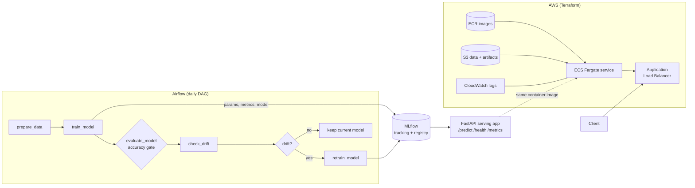
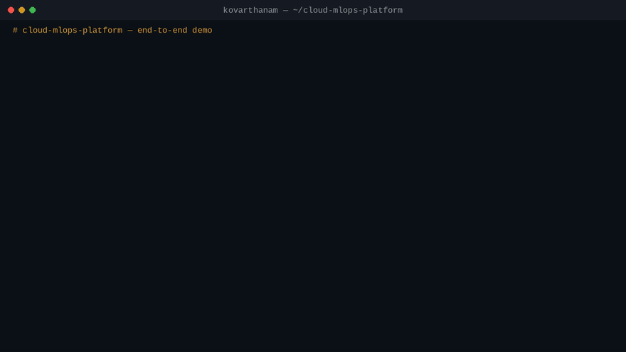

# cloud-mlops-platform

An end-to-end MLOps platform: a model is trained and tracked with **MLflow**,
orchestrated daily by **Airflow**, watched for **data drift** (PSI + KS, with
optional Evidently reports), retrained automatically when drift is detected,
served by a **FastAPI** app with Prometheus metrics, and deployed to **AWS**
(ECS Fargate behind an ALB) with **Terraform**.

The demo model is a RandomForest classifier on scikit-learn's bundled wine
dataset — chosen so the whole platform runs anywhere with zero data downloads.

## Why

Most ML projects stop at a notebook. This project demonstrates the platform
around the model — experiment tracking, a quality-gated training pipeline,
drift detection wired to retraining, containerised serving with metrics, and
the cloud infrastructure as code — the parts MLOps and AI-platform roles
actually ask for.

## Architecture



## Project structure

```
.
├── src/cloud_mlops/        # installable package
│   ├── data.py             # wine dataset loading, splits, drifted-data simulator
│   ├── train.py            # training pipeline + MLflow logging
│   ├── drift.py            # PSI + KS drift detection (thresholds documented)
│   └── evidently_report.py # optional Evidently HTML report (extra, not core)
├── app/main.py             # FastAPI serving app (health / predict / metrics)
├── scripts/                # CLI entry points
│   ├── run_training.py
│   ├── check_drift.py      # exits 1 + DRIFT_DETECTED when drift is flagged
│   └── demo.sh             # one-command end-to-end demo (see Demo section)
├── dags/ml_pipeline_dag.py # Airflow DAG: prepare → train → evaluate → drift → retrain
├── infra/terraform/        # AWS: S3, ECR, ECS Fargate + ALB, IAM, CloudWatch
├── tests/                  # pytest: training, drift, API
├── docs/demo.md            # demo walkthrough with captured real output
├── docker-compose.yml      # local stack: MLflow + API + Airflow + Postgres
├── Dockerfile              # API image
└── requirements.txt        # core deps (Airflow via Docker; see requirements-airflow.txt)
```

## Local quickstart

### 1. Train and serve without Docker

```bash
python -m venv .venv && source .venv/bin/activate
pip install -r requirements.txt

PYTHONPATH=src python scripts/run_training.py   # trains, logs to MLflow, writes models/model.pkl
PYTHONPATH=src:. uvicorn app.main:app --reload  # http://localhost:8000/docs

# drift check: clean data exits 0, drifted data exits 1 with DRIFT_DETECTED
PYTHONPATH=src python scripts/check_drift.py
PYTHONPATH=src python scripts/check_drift.py --drifted
```

Run the tests and linter:

```bash
pytest -q
ruff check src app scripts tests dags
```

### 2. Full local stack with Docker Compose

```bash
docker compose up --build
```

- API → http://localhost:8000/docs
- MLflow UI → http://localhost:5000
- Airflow UI → http://localhost:8080 (admin / admin), DAG `ml_pipeline`

## Demo


*35-second terminal demo with real output from a local run. Prefer video? [Watch the MP4 version](docs/demo.mp4).*

One command runs the whole story end to end — train, drift check on clean
data, drift check on shifted data, then serve the API and call it:

```bash
bash scripts/demo.sh
```

Captured output from a real run:

```text
run_id=b8608b6ef42b42738b48b4a0b4847e3b
accuracy=1.0000 f1_weighted=1.0000
...
NO_DRIFT                                     # clean batch, exit 0
DRIFT_DETECTED flagged_features=['alcohol', 'malic_acid', 'ash',
'alcalinity_of_ash', 'magnesium', 'total_phenols']   # shifted batch, exit 1
...
{"status":"ok","model_loaded":true,"model_path":"models/model.pkl"}
{"prediction":0,"class_name":"class_0"}
```

Full walkthrough with the complete outputs: **[docs/demo.md](docs/demo.md)**.

## How drift-triggered retraining works

1. The daily Airflow DAG trains a candidate model and logs it to MLflow.
2. An **evaluation gate** fails the run if test accuracy is below 0.90, so a
   bad model is never promoted.
3. `check_drift` compares the newest production batch against the training
   distribution per feature using **PSI** (flag at ≥ 0.25) and the
   **Kolmogorov–Smirnov test** (flag at p < 0.05).
4. If any feature is flagged, the DAG branches to retraining; otherwise the
   current model stays in production. The standalone
   `scripts/check_drift.py` exposes the same logic as an exit code, which is
   how a CI job or cron entry can trigger retraining too.
5. For human review, `cloud_mlops.evidently_report.generate_evidently_report`
   renders a full Evidently HTML drift report (optional extra:
   `pip install evidently`).

## Deploying to AWS

Prerequisites: AWS account + credentials configured, Terraform ≥ 1.6, Docker.

```bash
cd infra/terraform
terraform init
terraform plan
terraform apply        # creates S3, ECR, ECS cluster/service, ALB, IAM, logs

# push the API image (repository URL is a terraform output)
aws ecr get-login-password --region eu-central-1 | \
  docker login --username AWS --password-stdin <ecr_repository_url>
docker build -t <ecr_repository_url>:latest ../..
docker push <ecr_repository_url>:latest
```

The API is then reachable at the `api_url` terraform output.

> **Cost hygiene:** an ALB + Fargate service bills by the hour even when
> idle. This is a portfolio deployment — run `terraform destroy` as soon as
> you have finished evaluating it. Nothing in this stack needs to stay up.

## Tech stack

Python 3.11 · scikit-learn · MLflow · FastAPI · Prometheus · Apache Airflow ·
Docker / Docker Compose · Terraform · AWS (S3, ECR, ECS Fargate, ALB, IAM,
CloudWatch) · Evidently (optional) · pytest · Ruff · GitHub Actions CI
(python lint+test, terraform fmt/validate, docker build).

## License

MIT — see [LICENSE](LICENSE). Copyright (c) 2026 Kovarthanam Muthusamy.
