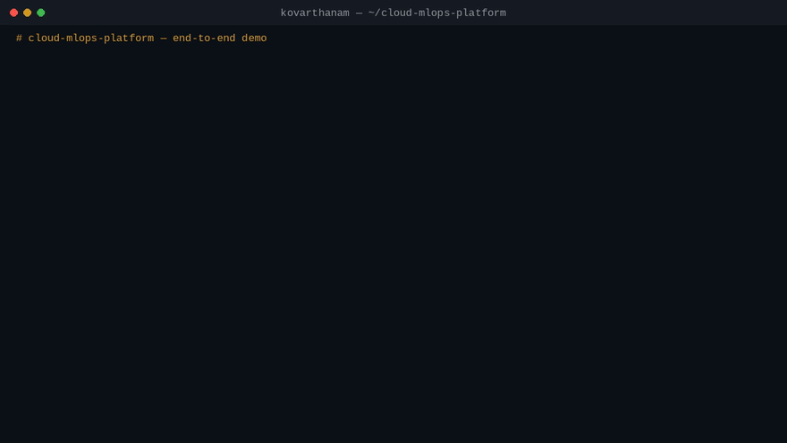

# Demo


*35-second terminal recording with real output from a local run — also
available as [demo.mp4](demo.mp4). Regenerate it with
`python3 docs/make_demo_video.py` (see the file header).*

A two-minute, end-to-end walkthrough of the platform. Run it yourself with
one command from the repository root:

```bash
bash scripts/demo.sh
```

or follow the steps below manually. All output shown here was captured from a
real local run (2026-11-05); your MLflow `run_id` and timings will differ.

## 1. Train the model

```bash
PYTHONPATH=src python scripts/run_training.py
```

```text
run_id=b8608b6ef42b42738b48b4a0b4847e3b
accuracy=1.0000 f1_weighted=1.0000
model saved to models/model.pkl
```

The run (parameters, accuracy, F1) is logged to MLflow, and the fitted
scikit-learn pipeline is written to `models/model.pkl` for serving.

## 2. Drift check — clean production batch

```bash
PYTHONPATH=src python scripts/check_drift.py   # exit code 0
```

```text
alcohol                      psi=  0.000 ks_p=  1.0000 [ok]
malic_acid                   psi=  0.000 ks_p=  1.0000 [ok]
...
proline                      psi=  0.000 ks_p=  1.0000 [ok]
NO_DRIFT
```

## 3. Drift check — shifted production batch

`--drifted` simulates a production batch whose feature means have shifted by
1.5 standard deviations — the situation drift monitoring exists to catch.

```bash
PYTHONPATH=src python scripts/check_drift.py --drifted   # exit code 1
```

```text
alcohol                      psi=  3.076 ks_p=  0.0000 [DRIFT]
malic_acid                   psi=  7.594 ks_p=  0.0000 [DRIFT]
ash                          psi=  1.964 ks_p=  0.0000 [DRIFT]
alcalinity_of_ash            psi=  1.815 ks_p=  0.0000 [DRIFT]
magnesium                    psi=  5.685 ks_p=  0.0000 [DRIFT]
total_phenols                psi=  4.195 ks_p=  0.0000 [DRIFT]
flavanoids                   psi=  0.000 ks_p=  1.0000 [ok]
...
DRIFT_DETECTED flagged_features=['alcohol', 'malic_acid', 'ash', 'alcalinity_of_ash', 'magnesium', 'total_phenols']
```

In the Airflow DAG this verdict branches the pipeline into a retraining run;
as a script, the exit code lets any CI job or cron entry do the same.

## 4. Serve the model and call the API

```bash
PYTHONPATH=src:. uvicorn app.main:app --port 8000
```

```bash
curl http://127.0.0.1:8000/health
# {"status":"ok","model_loaded":true,"model_path":"models/model.pkl"}

curl -X POST http://127.0.0.1:8000/predict -H "Content-Type: application/json" \
  -d '{"alcohol": 13.2, "malic_acid": 1.78, "ash": 2.14, "alcalinity_of_ash": 11.2,
       "magnesium": 100.0, "total_phenols": 2.65, "flavanoids": 2.76,
       "nonflavanoid_phenols": 0.26, "proanthocyanins": 1.28, "color_intensity": 4.38,
       "hue": 1.05, "od280/od315_of_diluted_wines": 3.4, "proline": 1050.0}'
# {"prediction":0,"class_name":"class_0"}

curl http://127.0.0.1:8000/metrics | grep predict_
# predict_requests_total{status="ok"} 1.0
# predict_latency_seconds_count 1.0
```

Interactive API documentation (Swagger UI) is available at
`http://localhost:8000/docs` while the server is running.

## 5. Tests

```bash
pytest -q
# 7 passed
```

The suite covers training (a loadable model with sane accuracy), drift
detection (identical data passes, shifted data is flagged) and the API
(`/health`, `/predict`, `/metrics`).
